 

---

### 👋 About

I build automation that runs without me watching it. At **GetRepaired.de** I designed and run an 18-workflow n8n system that takes a repair shop from *discovered* to *registered partner*: lead generation, enrichment, outreach, WhatsApp, tracking and monitoring. I also own the platform's quality, and I'm currently building partner document onboarding and verification.

I care about the unglamorous parts that make automation trustworthy: retries, deduplication, caps, error handling and a clear reason for every decision.

### 🎬 See it move

My portfolio has two animated, node-by-node walkthroughs where one lead travels through a real automation:

| | |
|---|---|
| **[Lead generation pipeline →](https://abhishrutg.github.io/Portfolio/#leadgen)** | Four workflows handing a lead to each other through PostgreSQL |
| **[Freelance: export lead engine →](https://abhishrutg.github.io/Portfolio/#freelance)** | A delivered Fiverr project: Google Maps → live-web check → contact discovery → AI score → Sheet |

### 🧰 Stack

### 📌 Featured work

| Project | What it is |
|---|---|
| **[Portfolio](https://github.com/AbhishrutG/Portfolio)** | My site: a single-file, no-build page with animated automation walkthroughs |
| **[RAG-Getrepaired-Project](https://github.com/AbhishrutG/RAG-Getrepaired-Project)** | A retrieval-augmented chatbot over the GetRepaired FAQ, with conversation memory and source citations |
| **[n8n-automation-portfolio](https://github.com/AbhishrutG/n8n-automation-portfolio)** | Production-grade n8n workflows: lead generation, email outreach and more |
| **[getrepaired-mock](https://github.com/AbhishrutG/getrepaired-mock)** | A mock website demo in plain HTML, CSS and JS |

### 🐍 Contributions

<picture>
  <source media="(prefers-color-scheme: dark)" srcset="https://raw.githubusercontent.com/AbhishrutG/AbhishrutG/output/github-snake-dark.svg" />
  <source media="(prefers-color-scheme: light)" srcset="https://raw.githubusercontent.com/AbhishrutG/AbhishrutG/output/github-snake.svg" />
  
</picture>

### 🤝 Open to

Freelance automation projects and full-time roles in automation engineering. The fastest way to reach me is through [my portfolio](https://abhishrutg.github.io/Portfolio/#contact).

